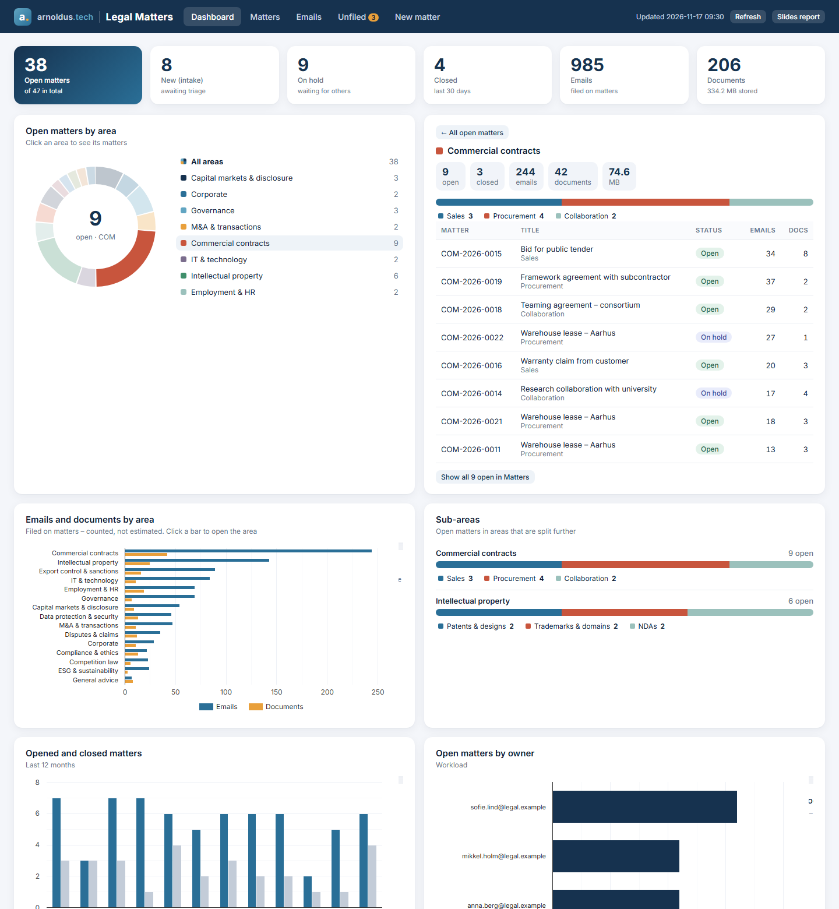
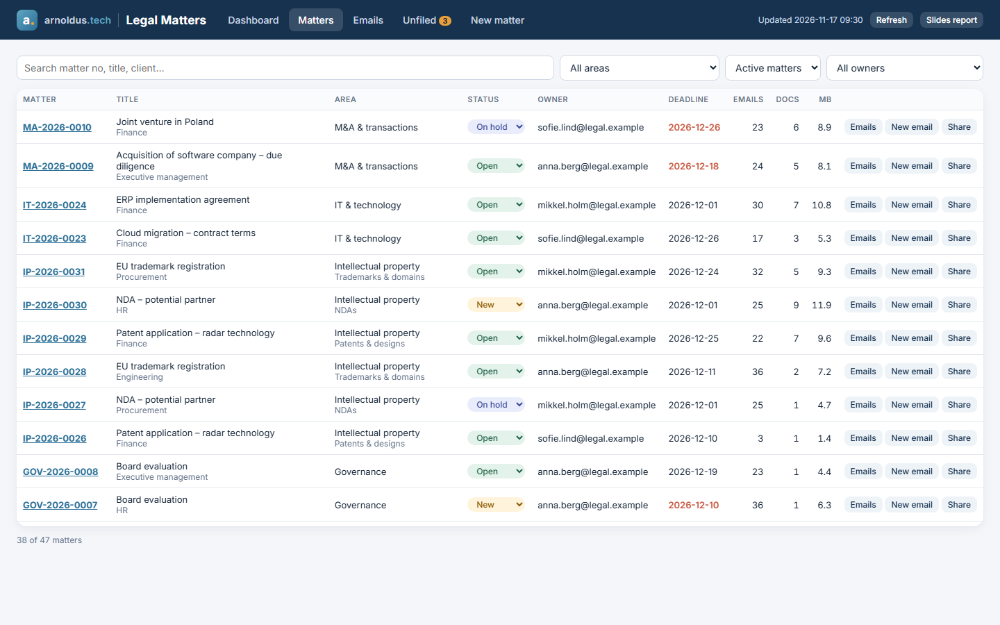
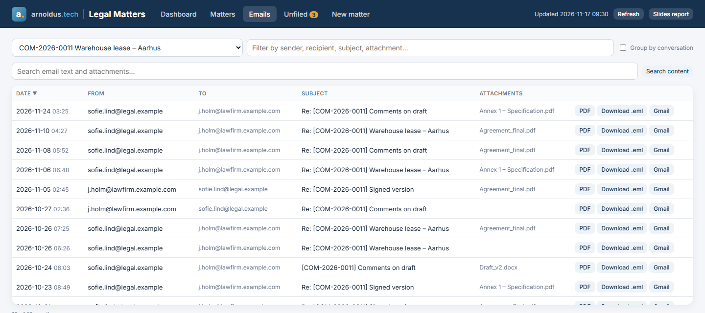
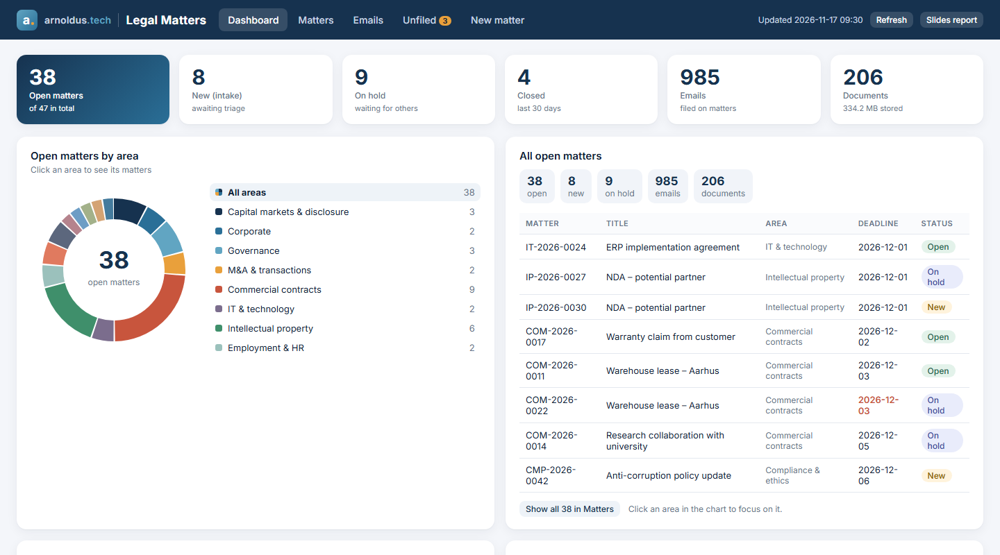
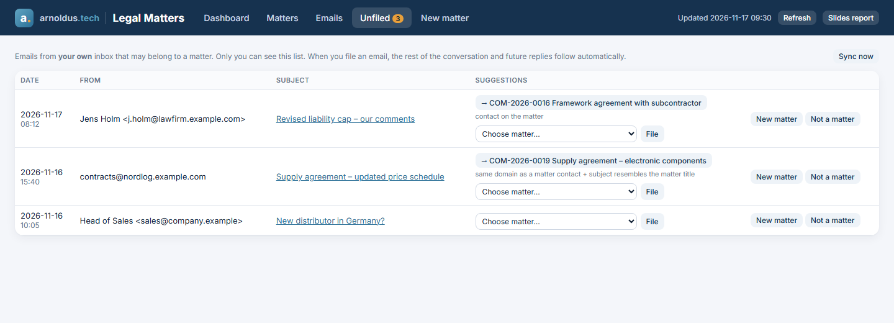

# Legal Matter Manager for Google Workspace

A lightweight matter intake and management system for an in-house legal team, built entirely on Google Workspace: **Sheets** as the register, **Drive** for matter folders, **Gmail** for correspondence, **Docs** for matter notes and **Slides** for reporting – glued together with Google Apps Script.

> Status: working prototype. All data in screenshots and demos is fictitious.



## Why

Small in-house legal teams rarely get a document management system – but they still need to know which matters are open, where the correspondence is, and what the team spends its work on. Most of that already lives in Google Workspace. This project turns it into a matter system without asking lawyers to change how they work: they keep writing emails in Gmail and documents in Drive, and the system files them on the right matter.

It is designed by a lawyer, with the trade-offs a legal function cares about – least-privilege access to mailboxes, nothing read before there is a reason to, and figures that are counted rather than guessed. It was built with an AI coding assistant.

## Screenshots

| Matter list | Email list per matter |
|---|---|
|  |  |
| **All open matters** | **Unfiled – suggestions only the mailbox owner sees** |
|  |  |

## What it does

| | |
|---|---|
| **Ask Legal – AI intake assistant** | Employees describe their need in a chat. The assistant (Claude) asks follow-up questions, opens the matter with area, priority, deadline and a summary, produces a draft from a template for standard requests (self-service, e.g. a mutual NDA), and hands everything else to a lawyer with a prepared summary, suggested next steps and the conversation. It acts only through four tools and follows an editable list of hand-over rules |
| **Intake** | A web form opens a matter with a unique number (`COM-2026-0007` = area code, year, running number), a Drive folder structure, a matter note (from an optional template) and a Gmail label |
| **Matter areas** | 15 default areas for the legal function of a listed company – capital markets, corporate, governance, M&A, commercial contracts, IT, IP, employment, data protection, export control, compliance, competition, ESG, disputes and general advice. Areas can have sub-areas: commercial contracts are split into *Sales*, *Procurement* and *Collaboration*; IP into patents, trademarks, licensing and *NDAs* |
| **Email filing without tags** | Emails are filed automatically when they reply to a filed email (`In-Reply-To` / `References`), belong to a filed conversation, are sent to a plus address (`legal+COM-2026-0007@…`) or mention the matter number. Filed as PDF + original `.eml` + attachments, labelled in Gmail and de-duplicated across team mailboxes via `Message-ID`. Google system notifications are never filed |
| **"Unfiled" queue** | Emails with weak signals (a matter's external contact, the same company domain, or a subject resembling the matter title) are suggested in a personal queue – visible only to the mailbox owner – where they can be filed, turned into a new matter, or dismissed |
| **Email list** | Per matter or across matters: date, direction, from, to, subject, attachments; sortable, filterable, grouped by conversation, with full-text search in filed emails and attachments |
| **Dashboard** | Open / new / on-hold / recently closed matters, an interactive donut by area with drill-down to sub-areas and matters, emails and documents by area, opened vs. closed per month, workload per owner (when there is more than one) and the most active matters. **Only counted figures – no estimated hours** |
| **Collaboration** | Team members get access to the matter folder. A matter's external contacts are recorded only to recognise their emails – nothing is shared outside the team |
| **Reporting** | One click builds a branded Google Slides deck with key figures, charts linked to the register and a *Focus* slide with placeholders for what the team wants to highlight |

## Architecture

```
Google Sheet "Matter register" (bound Apps Script)
 ├─ Matters        one row per matter, incl. email/document counts and folder size
 ├─ Areas          matter areas, sub-areas and Drive folder IDs
 ├─ Activity       log of emails, documents and status changes (de-duplication keys)
 ├─ Emails         one row per filed email – the email list
 ├─ Settings       options (PDF/.eml/attachments, internal domains, private label, exclusions)
 └─ Report data    generated chart data for Slides

Drive  <root>/
 ├─ 00 System/       the register
 ├─ 01 Matters/<Area>/<Matter no> – <Title>/
 │     ├─ 01 Correspondence/   filed emails (PDF) and attachments
 │     │     └─ Originals (.eml)/
 │     └─ 02 Documents/
 ├─ 02 Reports/      generated Slides reports
 └─ 03 Templates/    matter note templates

Gmail  label "Matters/<Matter no>" per matter
Web app (HtmlService): dashboard, matters, emails, unfiled queue, intake form
```

| Source file | Responsibility |
|---|---|
| `Config.gs` | Constants: sheets, columns, default areas, settings |
| `Setup.gs` | Menu, one-time setup, triggers, sheet formatting |
| `Matters.gs` | Intake, status, sharing, matter numbers, matter note |
| `MailSync.gs` | Email recognition and filing, document sync, counts, unfiled queue, email list |
| `Dashboard.gs` | Web app entry point and dashboard data |
| `Report.gs` | Google Slides report |
| `Demo.gs` | Demo data and area reset |
| `App.html` | The web app (dashboard, lists, forms) |

## Design principles

- **Least privilege.** Each user syncs only their own mailbox, under their own authorisation. No domain-wide delegation or service account with access to everyone's email.
- **Staged reading.** New emails are classified from headers only (subject, addresses, thread references). The body is fetched only when an email is filed. Threads labelled `Private`, excluded domains, newsletters and automated mail are skipped.
- **Private by default.** The "Unfiled" queue is stored in each user's own User Properties, never in the shared register.
- **Objective figures.** The dashboard and report show counts and sizes – not estimated time.
- **No hard-coded IDs.** Setup discovers or creates the folder structure and stores IDs in Script Properties, so the code can be deployed to any Drive.

## AI and data governance

The assistant is built as a showcase with fictitious data. For real use, these choices are deliberate:

- **Human in the loop.** The assistant never sends, signs or approves anything. Non-standard requests always go to a lawyer, following the *Escalation rules* sheet – which the legal team edits, not the model.
- **Minimal data.** Only the conversation and the template and rule lists are sent to the model – no other matters, emails or documents. The intake page tells employees not to enter confidential information beyond what is needed.
- **Narrow tools.** The model can open a matter, create a draft from an approved template, complete a self-service matter and hand over to a lawyer – nothing else.
- **Traceable.** Every action is logged in the Activity sheet, and the conversation is saved in the matter note.
- **Key handling.** The API key lives in Script Properties, never in the code. In production it belongs in a proper secret store, with a data processing agreement, no training on customer data, an agreed data location and a DPIA in place.

## Roadmap

1. ~~Thread recognition and "Unfiled" queue~~ ✅ · ~~Email list per matter~~ ✅ · ~~Interactive dashboard~~ ✅
2. ~~**Ask Legal** – AI intake, self-service NDA and hand-over~~ ✅ · next: AI suggestions for unfiled emails, and review of counterparty NDAs against a playbook
3. **"Get this email in my Gmail"** – re-import the archived `.eml` so a colleague can reply in the original thread (e.g. during holidays), with per-matter deputies
4. **Contact register** per matter, so contact matches can be filed automatically instead of suggested
5. **Gmail add-on** – "File to matter" and "Create matter from this email" in the Gmail side panel
6. **Confidential matters** – separate register and folder, access approved by the responsible lawyer and the head of legal

## Setup

Prerequisites: a Google account, [Node.js](https://nodejs.org/) and [clasp](https://github.com/google/clasp).

1. In Drive, create a folder (e.g. `Legal`) with a subfolder `00 System`, and a Google Sheet in it (e.g. `Matter register`).
2. Enable the Apps Script API at <https://script.google.com/home/usersettings>.
3. Clone this repo, then bind it to the sheet:
   ```bash
   npm install -g @google/clasp
   clasp login
   clasp create-script --parentId <spreadsheet-id> --rootDir src   # or copy .clasp.json.example to .clasp.json
   clasp push
   ```
4. Reload the sheet and run **⚖️ Matters → Setup (run first)**. Setup creates the sheets and folders and installs a 15-minute sync trigger.
5. Optional: **⚖️ Matters → Demo → Create demo matters** fills the system with 30 fictitious matters.
6. Optional: **Deploy → New deployment → Web app** (execute as *user accessing*, access *anyone with a Google account*). Only users with access to the register can see any data.

User guide: [docs/USER_GUIDE.md](docs/USER_GUIDE.md)

## Troubleshooting

- **`PERMISSION_DENIED` when opening the dashboard** – you are signed in to several Google accounts in the same browser, and Apps Script uses the browser's default account. Use a separate browser profile (or an incognito window) signed in only to the account that runs the system.

## Privacy note

All matter data stays in the user's own Google account/Workspace. The repository contains code only – no register data, no email and no IDs. `.clasp.json` (script binding) and `.clasprc.json` (credentials) are git-ignored.

## Licence

[MIT](LICENSE)
